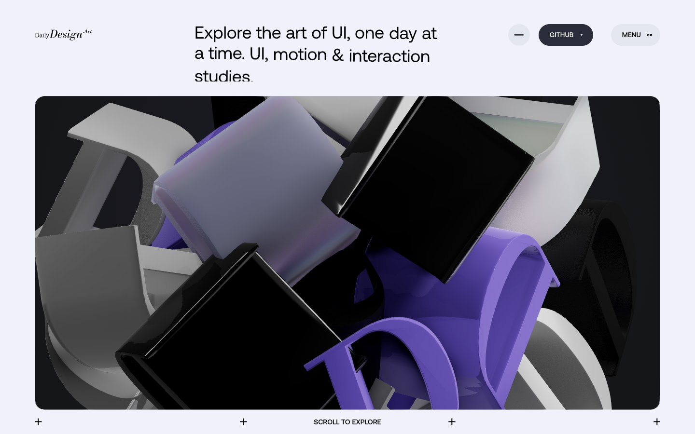
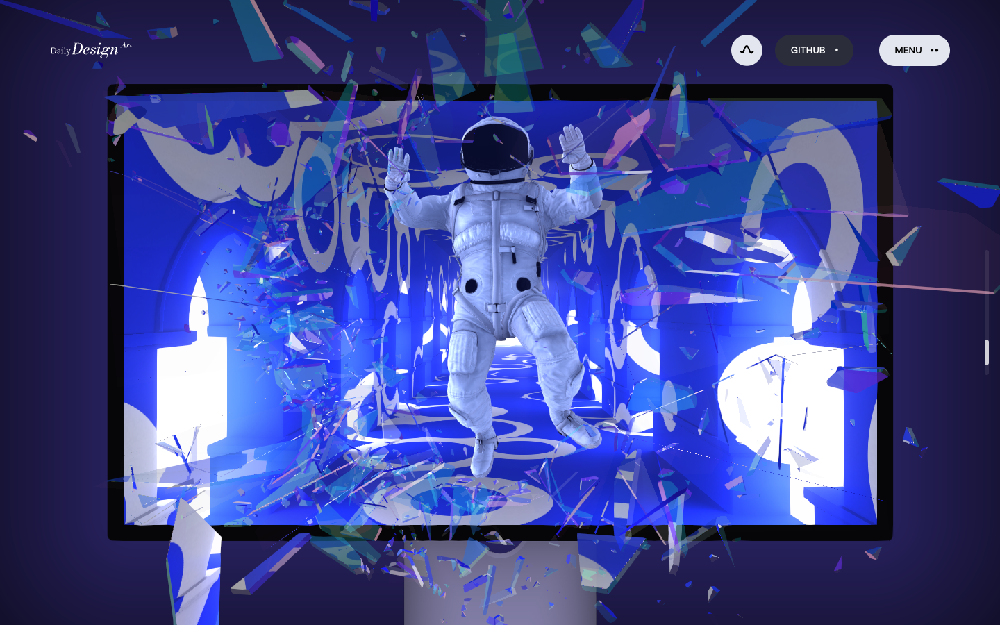

<div align="center">

# Daily Design .Art

**Explore the art of UI, one day at a time.**

WebGL · Three.js · GLSL · Node.js

</div>

一个围绕 UI、UX、动效与光学材质构建的三维交互展示项目。将实时渲染、滚动叙事与网页界面结合，呈现可交互的 3D 字形、隧道穿越、玻璃破碎、GPU 粒子与作品画廊，包含首页、About、作品列表及详情页。



<table>
  <tr>
    <td width="50%"></td>
    <td width="50%"></td>
  </tr>
  <tr>
    <td align="center">滚动叙事 · 玻璃破碎</td>
    <td align="center">GPU 粒子 · 品牌字标</td>
  </tr>
</table>

## 本地部署与启动

### 环境要求

- **Node.js 22 或更高版本**，以及随附的 npm。
- **Git**，用于克隆仓库。
- 支持 WebGL 的现代浏览器，建议开启硬件加速。

运行所需的页面、脚本、模型与媒体已包含在仓库中。常规构建和本地服务仅使用 Node.js 内置模块，**无需执行 `npm install`，也无需配置环境变量、数据库或 API Key**。

### 获取并运行

```bash
git clone https://github.com/Snychng/lusion-daily-design.git
cd lusion-daily-design

# 构建本地站点
npm run build

# 检查资源、页面与路由
npm run check

# 启动本地服务
npm run dev
```

启动后访问 **[http://127.0.0.1:4207/](http://127.0.0.1:4207/)**。

| 页面 | 本地地址 |
| --- | --- |
| 首页 | [http://127.0.0.1:4207/](http://127.0.0.1:4207/) |
| About | [http://127.0.0.1:4207/about](http://127.0.0.1:4207/about) |
| 作品列表 | [http://127.0.0.1:4207/projects](http://127.0.0.1:4207/projects) |

服务默认仅监听本机 `127.0.0.1:4207`，在终端按 `Ctrl+C` 停止。已有构建产物时，再次启动只需运行 `npm run dev`。

`npm run dev` 提供静态文件服务，不会自动构建或热更新。修改页面、样式、脚本或资源后，重新执行 `npm run build` 并刷新浏览器。请通过本地服务访问页面，不要直接打开 HTML 文件。

## 实现方式

项目采用 **静态页面 + WebGL 运行时 + 内容适配层** 的结构。页面内容、视觉资源与场景逻辑分开管理，由 Node.js 脚本组装为可在本地运行的站点。

| 模块 | 实现概览 |
| --- | --- |
| 页面与导航 | 使用预生成的 HTML、CSS 和 JavaScript，通过 History API 与页面生命周期管理站内导航和转场。 |
| 三维渲染 | 基于 Three.js r158 与 GLSL Shader，实现 3D 字形、光照、反射、折射，以及 Bloom、景深和抗锯齿等后处理。 |
| 滚动与交互 | 将滚动进度映射到场景阶段、镜头路径、骨骼动画与玻璃碎片动画，并接入指针、点击、按住和反向滚动。 |
| 粒子与模拟 | 使用 GPU 粒子更新、点云形态切换及独立的流体模拟模块，呈现场景漂浮、形体变换和指针扰动。 |
| 本地媒体 | 通过 HTML5 视频适配器播放仓库内的媒体，衔接全屏容器、播放暂停、进度与声音控制。 |
| 内容与构建 | 通过页面、路由、媒体和模型映射组织内容；构建脚本复制基础资源、应用内容覆盖与运行时补丁，输出到 `dist/`。 |

主要目录：

```text
.
├── brand-content/   # 页面内容、路由映射、媒体映射与品牌样式
├── brand-assets/    # 模型、贴图、字体、图片与视频
├── src/             # 本地播放器、模型与纹理源文件
├── reference/       # 构建使用的基础静态页面与运行时资源
├── scripts/         # 构建、静态检查与本地服务脚本
└── dist/            # 构建生成的站点
```

`dist/` 由 `npm run build` 重新生成，不作为手工编辑入口。常规本地部署直接使用仓库中已有的模型与媒体产物，无需重新生成素材。
